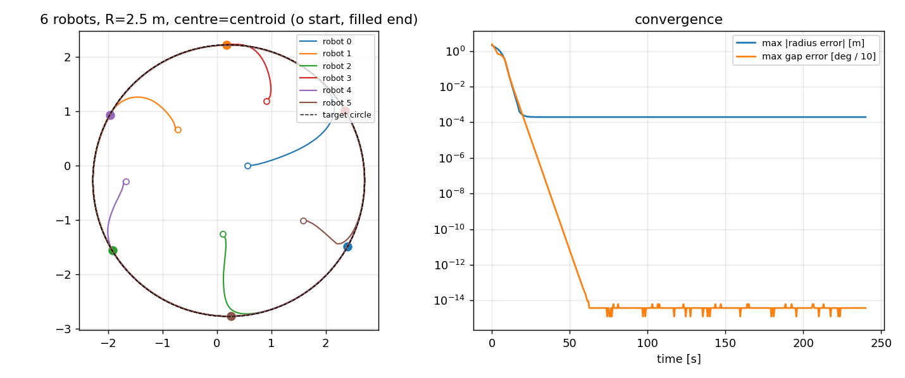

# circular_formation

Decentralised **circular formation control** for differential-drive robots
(TurtleBot3 Burger) on **ROS 2 Jazzy + Gazebo Harmonic (Ubuntu 24.04)**.

N robots converge onto a circle of radius `R`, evenly spaced, and can
optionally keep rotating around it at a rate `omega`. This is the formation
part only, extracted from the layout and spawn/bridge conventions of
[NSKsim](https://github.com/AliAlhasan6/NSKsim); none of its knowledge-graph /
SLAM / exploration code is included.



## Layout

```
circular_formation/
├── README.md  LICENSE  .gitignore
├── docs/offline_convergence.png
├── tools/run_offline_sim.py            # run + plot the controller, no ROS needed
└── ros2_ws/src/circular_formation/     # the colcon package
    ├── package.xml  setup.py  setup.cfg  resource/
    ├── circular_formation/
    │   ├── geometry.py                 # angles, odom->world, ring gaps     (pure)
    │   ├── unicycle.py                 # velocity -> (v, w), saturation     (pure)
    │   ├── control_law.py              # the formation control law          (pure)
    │   ├── metrics.py                  # radius / spacing error             (pure)
    │   ├── spawn_layout.py             # initial poses                      (pure)
    │   ├── simulation.py               # offline kinematic simulator        (pure)
    │   ├── robot_model.py              # namespaced Burger SDF              (pure)
    │   ├── formation_controller.py     # ROS node, one per robot
    │   └── formation_monitor.py        # ROS node: metrics + RViz markers
    ├── launch/circular_formation.launch.py
    ├── config/circular_formation.yaml
    ├── worlds/formation_world.sdf
    ├── rviz/circular_formation.rviz
    └── test/                           # pytest, runs without ROS
```

"Pure" modules import nothing from ROS, so the control law can be tested and
tuned on any machine. Only the two nodes and the launch file need ROS.

## Control law (per robot, from its own pose and its peers' poses)

1. **Centre** `c`: a fixed point, or the centroid of the robots it can see
   (self included), so no leader or shared reference is needed.
2. **Radial**: `u_r = -k_radial (rho - R)` pulls the robot onto the circle.
3. **Angular**: `theta_dot = omega + k_angular (gap_next - gap_prev)`, where
   the gaps are the angles to the next and previous robot around `c`. The
   only equilibrium is equal gaps, an evenly spaced ring. Neighbours come from
   sorting angles, so nothing about ordering has to be agreed beforehand.
4. **Separation**: repulsion inside `d_safe` for the transient.

The desired velocity `u = u_r e_r + max(rho, rho_min) theta_dot e_theta + u_rep`
is turned into `(v, w)` by feedback linearisation about a point `look_ahead`
(0.15 m) ahead of the base, then scaled uniformly to `v_max` / `w_max`. The
formation radius therefore refers to that point; for a robot moving tangentially
the base differs by only a few millimetres.

## Requirements

Ubuntu 24.04, ROS 2 Jazzy, Gazebo Harmonic:

```bash
sudo apt install ros-jazzy-ros-gz ros-jazzy-turtlebot3-gazebo \
                 ros-jazzy-rviz2 ros-jazzy-tf2-ros python3-pytest python3-yaml
```

## Build and run

```bash
cd ros2_ws
source /opt/ros/jazzy/setup.bash
colcon build --packages-select circular_formation
source install/setup.bash

ros2 launch circular_formation circular_formation.launch.py
ros2 launch circular_formation circular_formation.launch.py \
    num_robots:=6 radius:=2.5 omega:=0.05 rviz:=true
```

| Launch argument | Default | Meaning |
|---|---|---|
| `num_robots` | 5 | team size (>= 2) |
| `radius` | 2.0 | circle radius, m |
| `omega` | 0.05 | rotation rate, rad/s, CCW positive; `0` = static ring |
| `center_mode` | centroid | `centroid` (leaderless) or `fixed` |
| `center_x`, `center_y` | 0, 0 | fixed centre, also the spawn centre |
| `spawn_layout`, `spawn_scale` | spiral, 0.8 | `spiral` scatter or `ring` |
| `headless` | false | run the gz server without the GUI |
| `rviz` | false | start RViz2 (slows the sim; keep off for timed runs) |
| `params_file` | config yaml | gains, limits, tolerances |

Keep `radius * omega` below `v_max` (0.20 m/s), otherwise the robots cannot
keep up with the rotation.

Topics: `/robot_N/cmd_vel` (Twist) and `/robot_N/odom` (Odometry) per robot;
`/formation/metrics` (`[mean_radius, mean_radius_err, max_radius_err,
max_gap_err_deg, min_separation, converged]`) and `/formation/markers`.
The monitor logs `FORMATION CONVERGED` once both errors stay inside
`tol_radius` / `tol_gap_deg` for `hold_time` seconds.

## Without ROS

```bash
python3 tools/run_offline_sim.py --robots 6 --radius 2.5 --out docs/offline_convergence.png
cd ros2_ws/src/circular_formation && python3 -m pytest -q
```

## What has and has not been verified

Run and passing here (55 tests): the control law, geometry, unicycle mapping,
closed-loop convergence in the offline simulator (3, 5 and 8 robots, fixed and
centroid centre, rotating and static, tight start, no collisions), the SDF
rewriting (also checked against the real stock Burger `model.sdf` from the
`turtlebot3_simulations` jazzy branch), and static consistency of the YAML,
launch arguments and entry points.

**Not run:** the ROS nodes, the launch file and the Gazebo world, because ROS 2
and Gazebo are not installed in the environment this was written in. Expect to
check the first launch yourself. The most likely places for small fixes are
the GUI plugin block in `formation_world.sdf` and finding the TurtleBot3
model path (`turtlebot3_gazebo` must be installed).

Odometry is relative to each robot's spawn pose, so the nodes add the spawn
poses the launch file passes in. If you spawn robots some other way, pass the
same poses as `spawn_xs / spawn_ys / spawn_yaws`.

## Licence

MIT. The Burger SDF rewriting and the spawn/bridge/namespace conventions are
adapted from NSKsim (MIT, (c) 2026 Ali Alhasan); see `LICENSE`.
